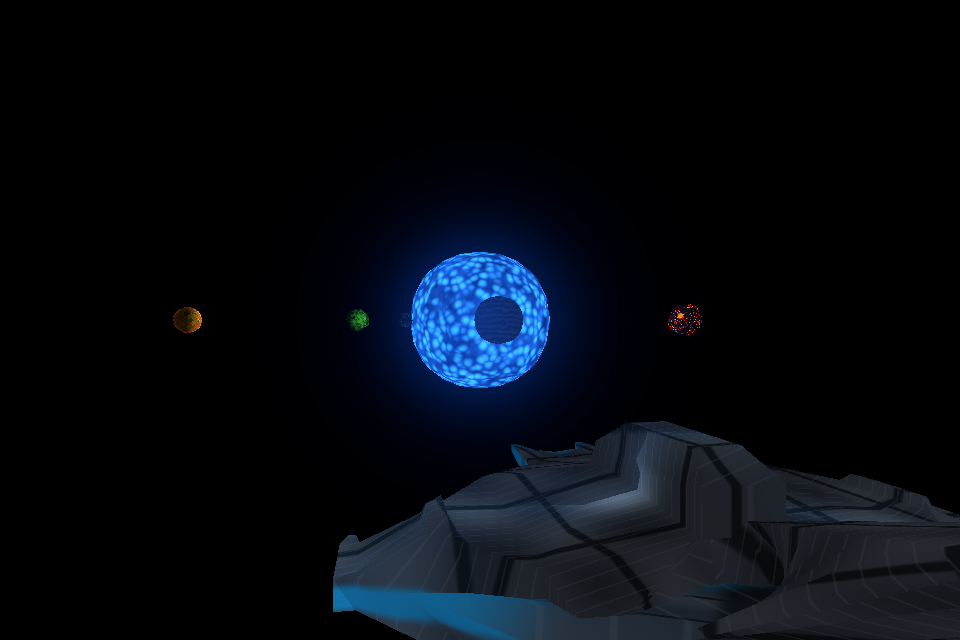
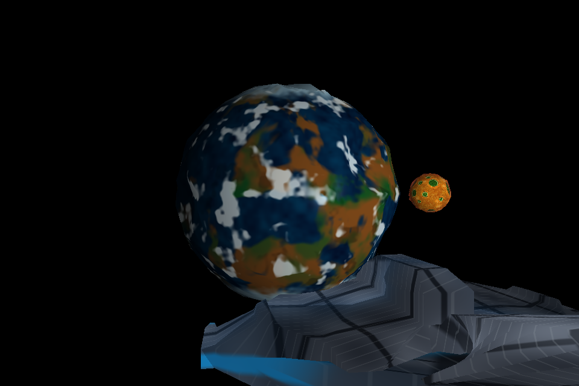
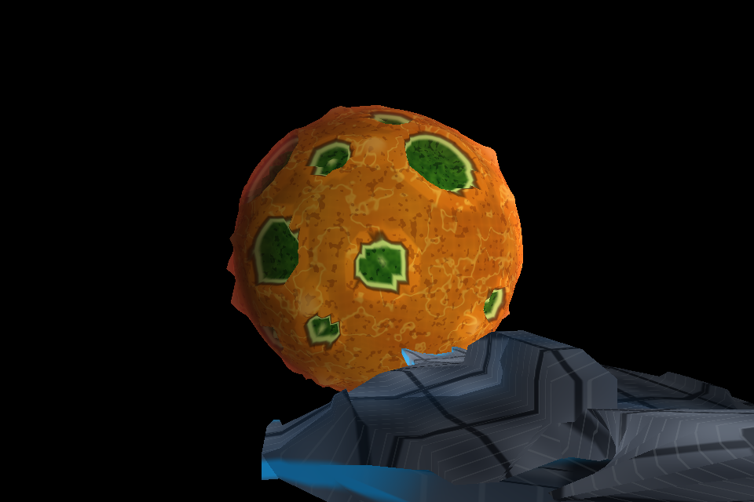

# Space Travel

En este repositorio se encuentra nuestra implementación de un renderer que muestra un sistema solar con varios planetas hecho en Rust. El proyecto permite moverse con una nave sobre el plano eclíptico, acercarse a los planetas, rodearlos y explorar el sistema en general.

## Integrantes del grupo

- Santiago Cordero
- Diego Gudiel
- Adaír Velásquez

## Video de demostración

El video demostrativo de la ejecución de nuestro proyecto se puede ver (https://www.youtube.com/watch?v=i85CekGwNGg)


## Capturas

Capturas tomadas del video de demostración:

<!-- Guardar las capturas en docs/capturas/ y descomentar las líneas que correspondan:




-->


## Controles

| Tecla | Función |
|---|---|
| `W` / `S` | Avanzar / retroceder |
| `A` / `D` | Desplazarse hacia la izquierda / derecha |
| `←` / `→` | Girar orientar la nave |


## Shaders implementados

Todos los shaders son funciones de fragmento escritas por nosotros en `src/shaders.rs`: reciben cada fragmento (píxel) del triángulo y devuelven su color. Usan las funciones de ruido (FBM y ruido celular) de `src/procedural.rs`.

### Nave

Para la nave implementamos un shader de casco con paneles, uniones, desgaste, iluminación envolvente, reflejos suaves, rim lighting y franjas cian animadas.

### Neutron star

Implementamos una estrella de neutrones mediante un shader emisivo animado que combina FBM y ruido celular para producir turbulencia y variación sobre la superficie.

### Ocean planet (planeta 1)

Planeta tipo océano. Mezcla océanos azules, continentes café/verdes (según humedad), casquetes de hielo en los polos y nubes animadas que se desplazan con el tiempo y proyectan sombra. Incluye iluminación difusa y un brillo especular sobre el agua.

### Gas giant (planeta 2)

Gigante gaseoso con bandas de latitud deformadas por ruido y una tormenta con anillos que giran con el tiempo. Las bandas fluyen lentamente para que la atmósfera se vea viva.

### Green planet (planeta 3)

Planeta cubierto de vegetación: FBM a dos escalas para zonas de bosque oscuro y claro, con iluminación difusa.

### Purple planet (planeta 4)

Planeta volcánico de roca morada oscura con fisuras de lava generadas con ruido, y un lago de lava dentro del cráter principal del modelo. La lava pulsa y fluye con el tiempo, y sigue brillando en el lado nocturno.

### Rick planet (planeta 5)

Planeta naranja inspirado en Rick and Morty. El shader lee la altura real de la malla (distancia al centro menos el radio base) para colorear: las cuencas hundidas son verdes con musgo, los anillos y montículos centrales son verde claro, y los bordes y bultos elevados son naranja claro. Añade remolinos y poros con ruido, un contorno oscuro en el borde de cada cuenca y un resplandor rojizo en el borde del planeta.


## Modelos utilizados

Todos los modelos están en `assets/obj` en formato `.obj` (el renderer solo usa vértices y caras).

| Modelo | Descripción | Triángulos |
|---|---|---|
| `nave.obj` | Nave del jugador, modelada en Blender por Santiago Cordero | - |
| `sphere.obj` | Esfera base, usada para la estrella y el planeta 2 | 192 |
| `planet1.obj` | Planeta 1: esfera deformada con ruido fractal (montañas) y cráteres con borde elevado | 2352 |
| `planeta_verde.obj` | Planeta 3: derivado de `sphere.obj` con colinas redondeadas | 3072 |
| `planeta_morado.obj` | Planeta 4: derivado de `sphere.obj` con cráteres hundidos y bordes elevados | 3072 |
| `planeta_rick.obj` | Planeta 5: esfera con 23 cuencas circulares (con anillo interior y montículo central) y 30 bultos en la superficie | 9408 |


## Ejecución del Proyecto

El proyecto, como fue mencionado anteriormente, fue realizado con Rust, por lo que las únicas dependencias son rust y cargo. Para correr el proyecto, solo se debe de ejecutar esto desde la raíz del repositorio:

```bash
cargo run --release
```

Es recomendado ejecutar el código con --release para tener mejor performance por las optimizaciones que hace cargo con esa flag activa.

## Estructura del proyecto

El proyecto está dividido en la siguiente estructura:

```bash
.
├── assets
│   └── obj
│       ├── nave.obj
│       ├── planet1.obj
│       ├── planeta_morado.mtl
│       ├── planeta_morado.obj
│       ├── planeta_rick.obj
│       ├── planeta_verde.mtl
│       ├── planeta_verde.obj
│       └── sphere.obj
├── Cargo.lock
├── Cargo.toml
├── README.md
└── src
    ├── algorithms
    │   ├── barycentric.rs
    │   ├── mod.rs
    │   ├── scanline.rs
    │   ├── triangle.rs
    │   └── wireframe.rs
    ├── camera.rs
    ├── framebuffer.rs
    ├── line.rs
    ├── main.rs
    ├── model.rs
    ├── parallelism
    │   ├── mod.rs
    │   └── thread.rs
    ├── procedural.rs
    ├── shaders.rs
    └── worldobjects.rs

6 directories, 26 files
```

- `./assets/obj`: contiene los modelos utilizados para tanto los planetas como la nave (modelo que fue realizado por Santiago Cordero para el laboratorio #4)
- `./src/algorithms`: contiene la rasterización de triángulos, interpolación de fragmentos y algoritmos gráficos del renderer
- `./src/parallelism`: divide el framebuffer en bandas horizontales que se renderizan con threads
- `./src/main.rs`: construye la escena, actualiza las órbitas y transformaciones, y coordina el proceso de renderizado
- `./src/camera.rs`, `model.rs` y `framebuffer.rs`: implementan la cámara, la carga de modelos y los buffers de color, profundidad y emisión
- `./src/shaders.rs` y `procedural.rs`: contienen los shaders de fragmentos y las funciones de ruido utilizadas para generar sus efectos
- `./src/worldobjects.rs`: guarda la información de los planetas (tanto su mesh como sus propiedades en sí como objetos del mundo, tales como su velocidad de rotación, posición, etc...)
